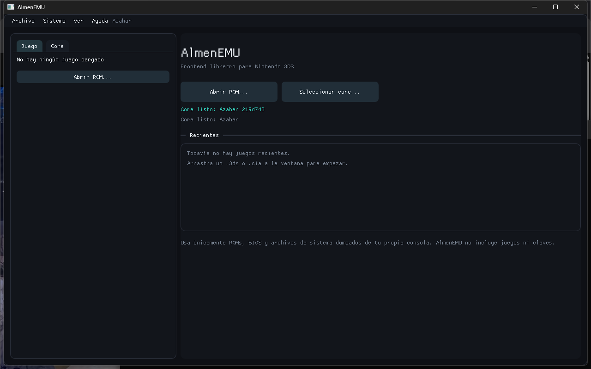

# AlmenEMU

Frontend de escritorio para emular **Nintendo 3DS** en Windows, Linux y macOS.
Usa como motor el core **libretro de Azahar** (GPL-3.0) y añade una interfaz propia,
gestión de biblioteca, opciones del core, audio, mandos y savestates.

> Estado: **M2 implementado**. Render hardware **OpenGL 4.3** en Windows/Linux
> (verificado en Windows y en Linux headless con un core simulado) y fallback software.
> macOS seguirá usando software hasta M3 (Vulkan + MoltenVK).
>
> El host libretro tiene **tests de integración headless** (`ctest`) con un core simulado:
> no necesitan GPU, ventana ni ROM.
>
> Plan completo, backlog y criterios de release: [`docs/PLAN.md`](docs/PLAN.md).




## Qué incluye

- Carga dinámica de cualquier core libretro; por defecto busca `azahar_libretro`.
- Render hardware OpenGL 4.3 con FBO propio y fallback software.
- Presentación OpenGL 3.3+ para la UI (ImGui).
- Audio S16 estéreo con cola y limitación de latencia.
- Teclado y mandos SDL3 (layout Nintendo).
- Opciones del core expuestas en la UI (`SET_CORE_OPTIONS_V2`).
- Savestates (`F5`/`F9`), capturas BMP (`F12`), pausa (`F1`) y reinicio (`F2`).
- Lista de recientes persistente.
- Arrastrar y soltar ROMs o cores sobre la ventana.
- Diálogos nativos de archivo con SDL3.
- Tests headless del host libretro con un core simulado (`ctest`).

## Requisitos

- CMake 3.24 o superior.
- Compilador con C++20 (MSVC 2022, GCC 12+, Clang 15+).
- Git y conexión a internet la primera vez (CMake descarga SDL3 e ImGui).
- Python 3 opcional, para descargar el core.
- GPU con **OpenGL 3.3+** para la interfaz; **OpenGL 4.3** para el render hardware.
- El core **Azahar libretro** para tu plataforma.

### Dependencias en Linux (Debian/Ubuntu)

```bash
sudo apt install build-essential cmake git ninja-build \
  libasound2-dev libpulse-dev libudev-dev \
  libx11-dev libxext-dev libxrandr-dev libxi-dev libxcursor-dev libxfixes-dev \
  libwayland-dev libxkbcommon-dev libegl1-mesa-dev libgles2-mesa-dev
```

En macOS: Xcode Command Line Tools y, si usas Ninja, `brew install ninja`.

## Compilar

### Windows (MSVC)

```powershell
cmake -S . -B build -G "Visual Studio 17 2022" -A x64
cmake --build build --config Release --parallel
```

El ejecutable queda en `build/Release/AlmenEMU.exe`.

### Linux / macOS

```bash
cmake -S . -B build -DCMAKE_BUILD_TYPE=Release
cmake --build build --parallel
```

El ejecutable queda en `build/AlmenEMU`.

También puedes usar los presets:

```bash
cmake --preset windows   # o linux / macos
cmake --build --preset windows
```

### Tests

Los tests no necesitan GPU, ventana, ROM ni el core de Azahar: `host_tests` usa un core
libretro simulado (`tests/fake_core`) y un backend de vídeo de prueba, y `video_tests`
 comprueba la lógica pura de presentación (`src/video/PixelConversion`: formatos de píxel,
UVs, orden de filas del readback y política del FBO).

```bash
cmake --preset linux -DALMENEMU_BUILD_TESTS=ON
cmake --build --preset linux --parallel
ctest --test-dir build --output-on-failure -C Release
```

Cubren el ciclo de vida software (opciones, vídeo, audio, input y savestates), el rechazo
de contextos no OpenGL (Vulkan), el fallback software cuando el backend rechaza el render
hardware, el ciclo `context_reset`/`context_destroy` y el readback RGBA8 del backend. Los
tests de vídeo verifican la expansión de 5 y 6 bits, el pitch acolchado, el recorte de UVs
con un FBO *grow-only* y que un readback más corto que el frame se rechaza. En total, 166
comprobaciones. Se pueden desactivar con `-DALMENEMU_BUILD_TESTS=OFF`.

## Instalar el core Azahar

Opción rápida:

```bash
python3 scripts/fetch_core.py
```

El script descarga el último release de Azahar para tu plataforma y deja el core en
`cores/`. Después vuelve a compilar (la target `copy_cores` lo copia junto al ejecutable)
o cópialo manualmente a `build/Release/cores/` / `build/cores/`.

Opción manual:

1. Entra en <https://github.com/azahar-emu/azahar/releases>.
2. Descarga el ZIP `azahar-libretro-...` de tu plataforma.
3. Extrae `azahar_libretro.dll`, `.so` o `.dylib` en `cores/`.

El core también se puede seleccionar desde **Archivo → Seleccionar core...** o pasar por CLI:

```bash
./AlmenEMU --core cores/azahar_libretro.so /ruta/juego.3ds
```

Para forzar el renderer software del core (útil para diagnosticar o en GPUs sin
OpenGL 4.3):

```bash
./AlmenEMU --software --core cores/azahar_libretro.so /ruta/juego.3ds
```

## Uso

1. Abre **Archivo → Abrir ROM...** o arrastra un `.3ds`, `.cci`, `.cxi`, `.app`, `.cia`
   o `.3dsx`.
2. Ajusta el layout y las opciones en la pestaña **Core** del panel lateral.
3. `F5` guarda un savestate y `F9` lo carga. Se guardan por juego en el directorio de datos.

### Controles de teclado

| Acción | Tecla |
|---|---|
| D-pad | Flechas |
| Circle Pad | `WASD` |
| A / B / X / Y | `K` / `J` / `L` / `I` |
| L / R | `Q` / `E` |
| Start / Select | `Enter` / `Backspace` |
| Pausa | `F1` |
| Reiniciar | `F2` |
| Guardar / cargar estado | `F5` / `F9` |
| Pantalla completa | `F11` |
| Captura | `F12` |
| Abrir ROM | `Ctrl+O` |
| Salir | `Ctrl+Q` |

Con mando se usa el layout Nintendo: Sur = A, Este = B, Norte = X, Oeste = Y.
El stick izquierdo es el Circle Pad y el derecho el C-Stick.

## Estructura

```text
src/
  app/Application.*      ventana, contexto OpenGL, UI, input, hotkeys
  core/LibretroCore.*    carga dinámica del .dll/.so/.dylib
  core/LibretroHost.*    callbacks libretro, vídeo, audio, opciones
  video/VideoBackend.h   interfaz de presentación
  video/OpenGLBackend.*  FBO, texturas, contexto hardware y fallback software
  main.cpp
third_party/libretro/    cabecera MIT de libretro
cores/                   cores locales (ignorados por git)
scripts/fetch_core.py    descarga del core Azahar
tests/                   core simulado y tests headless del host
docs/                    capturas y documentación
```

## Roadmap

- [x] Carga de core y ROM.
- [x] Render software, audio, teclado, mando, savestates y capturas.
- [x] Opciones del core y lista de recientes.
- [x] Render hardware OpenGL 4.3 en Windows/Linux (verificado en Windows y en Linux
  headless; falta validar Azahar real en Linux).
- [x] Tests headless del host con core simulado y CI que ejecuta `ctest`.
- [ ] Render Vulkan 1.1 + MoltenVK en macOS.
- [ ] Touchscreen y C-Stick completos.
- [ ] Configuración por juego y perfiles de mandos.
- [ ] Carátulas y metadatos de biblioteca.
- [ ] Shaders y escalado entero.
- [ ] Empaquetado: MSI/ZIP, AppImage/Flatpak, DMG universal.
- [ ] Firma y notarización en macOS (entitlement JIT para Dynarmic).
- [ ] Empaquetado y releases (la CI de build + tests ya existe).

## Notas técnicas

- El core de Azahar usa `RETRO_ENVIRONMENT_SET_HW_RENDER`. El frontend solo acepta
  contextos OpenGL de escritorio (`RETRO_HW_CONTEXT_OPENGL_CORE`/`OPENGL`); cualquier otra
  API se rechaza y el core cae a software. Crea el contexto, entrega un FBO propio mediante
  `get_current_framebuffer`, llama a `context_reset` tras `retro_load_game` y presenta el
  FBO con ImGui. Al cerrar, invoca `context_destroy` antes de `retro_deinit`. El renderer
  software sube el framebuffer del core a una textura.
- El contexto de UI pide OpenGL 4.3, con fallback a 4.1/3.3. Si no hay 4.3, el core se
  fuerza a `Software`.
- Vsync está desactivado y el bucle se limita a ~60 Hz con `SDL_DelayPrecise`; así se
  evita la caída a 30 Hz cuando un frame de core+UI roza el intervalo de refresco.
- En macOS no se puede usar OpenGL 4.3 (el máximo es 4.1). Para hardware hay que usar
  Vulkan con MoltenVK, o quedarse con software (M3).
- Los cores de release de Azahar para Windows/Linux son x86_64. En Linux ARM64 hay que
  compilar Azahar desde fuente con `-DENABLE_LIBRETRO=ON`.

## Licencia y legalidad

AlmenEMU se distribuye bajo **GPL-3.0-or-later**. Azahar también es GPL-3.0: si
redistribuyes el core junto a la app, debes publicar el código correspondiente y conservar
los avisos. Consulta `LICENSE` y `THIRD_PARTY_NOTICES.md`.

No se incluyen ROMs, BIOS, firmware, claves ni archivos de sistema de Nintendo. Usa
únicamente volcados de tu propia consola. El proyecto no está afiliado a Nintendo ni al
equipo de Azahar.
