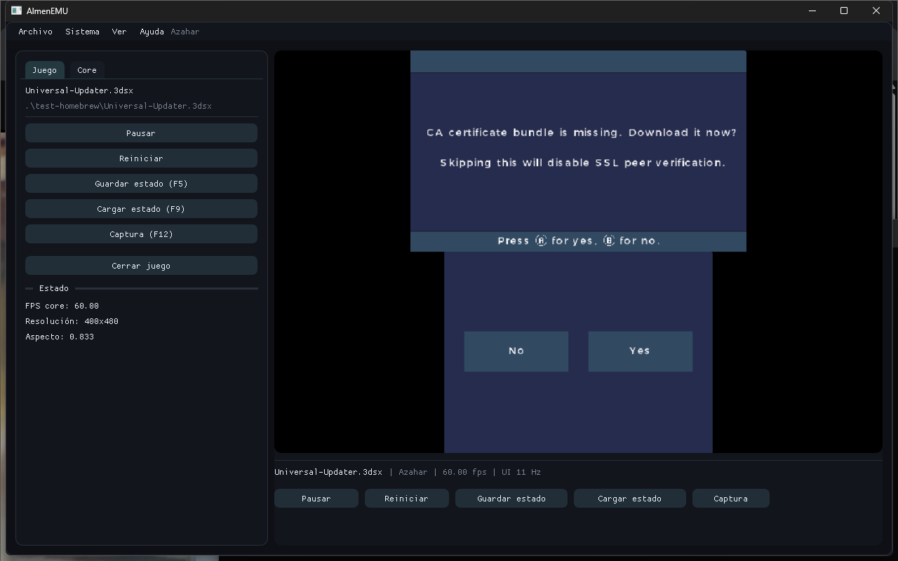

# AlmenEMU

Frontend de escritorio para emular **Nintendo 3DS** en Windows, Linux y macOS.
Usa como motor el core **libretro de Azahar** (GPL-3.0) y añade una interfaz propia,
gestión de biblioteca, opciones del core, audio, mandos y savestates.

> Estado: **MVP funcional**. Funciona con el renderer software del core. El siguiente
> paso es implementar el render hardware (OpenGL 4.3 / Vulkan 1.1) para rendimiento real.




## Qué incluye

- Carga dinámica de cualquier core libretro; por defecto busca `azahar_libretro`.
- Render software con conversión a `XRGB8888`, escalado y pantalla dual.
- Audio S16 estéreo con cola y limitación de latencia.
- Teclado y mandos SDL3 (layout Nintendo).
- Opciones del core expuestas en la UI (`SET_CORE_OPTIONS_V2`).
- Savestates (`F5`/`F9`), capturas BMP (`F12`), pausa (`F1`) y reinicio (`F2`).
- Lista de recientes persistente.
- Arrastrar y soltar ROMs o cores sobre la ventana.
- Diálogos nativos de archivo con SDL3.

## Requisitos

- CMake 3.24 o superior.
- Compilador con C++20 (MSVC 2022, GCC 12+, Clang 15+).
- Git y conexión a internet la primera vez (CMake descarga SDL3 e ImGui).
- Python 3 opcional, para descargar el core.
- El core **Azahar libretro** para tu plataforma.

### Dependencias en Linux (Debian/Ubuntu)

```bash
sudo apt install build-essential cmake git ninja-build \
  libasound2-dev libpulse-dev libudev-dev \
  libx11-dev libxext-dev libxrandr-dev libxi-dev libxcursor-dev libxfixes-dev \
  libwayland-dev libxkbcommon-dev libegl1-mesa-dev libgles2-mesa-dev
```

En macOS: Xcode Command Line Tools y, si usas Ninja, `brew install ninja`.

## Compilar

### Windows (MSVC)

```powershell
cmake -S . -B build -G "Visual Studio 17 2022" -A x64
cmake --build build --config Release --parallel
```

El ejecutable queda en `build/Release/AlmenEMU.exe`.

### Linux / macOS

```bash
cmake -S . -B build -DCMAKE_BUILD_TYPE=Release
cmake --build build --parallel
```

El ejecutable queda en `build/AlmenEMU`.

También puedes usar los presets:

```bash
cmake --preset windows   # o linux / macos
cmake --build --preset windows
```

## Instalar el core Azahar

Opción rápida:

```bash
python3 scripts/fetch_core.py
```

El script descarga el último release de Azahar para tu plataforma y deja el core en
`cores/`. Después vuelve a compilar (la target `copy_cores` lo copia junto al ejecutable)
o cópialo manualmente a `build/Release/cores/` / `build/cores/`.

Opción manual:

1. Entra en <https://github.com/azahar-emu/azahar/releases>.
2. Descarga el ZIP `azahar-libretro-...` de tu plataforma.
3. Extrae `azahar_libretro.dll`, `.so` o `.dylib` en `cores/`.

El core también se puede seleccionar desde **Archivo → Seleccionar core...** o pasar por CLI:

```bash
./AlmenEMU --core cores/azahar_libretro.so /ruta/juego.3ds
```

## Uso

1. Abre **Archivo → Abrir ROM...** o arrastra un `.3ds`, `.cci`, `.cxi`, `.app`, `.cia`
   o `.3dsx`.
2. Ajusta el layout y las opciones en la pestaña **Core** del panel lateral.
3. `F5` guarda un savestate y `F9` lo carga. Se guardan por juego en el directorio de datos.

### Controles de teclado

| Acción | Tecla |
|---|---|
| D-pad | Flechas |
| Circle Pad | `WASD` |
| A / B / X / Y | `K` / `J` / `L` / `I` |
| L / R | `Q` / `E` |
| Start / Select | `Enter` / `Backspace` |
| Pausa | `F1` |
| Reiniciar | `F2` |
| Guardar / cargar estado | `F5` / `F9` |
| Pantalla completa | `F11` |
| Captura | `F12` |
| Abrir ROM | `Ctrl+O` |
| Salir | `Ctrl+Q` |

Con mando se usa el layout Nintendo: Sur = A, Este = B, Norte = X, Oeste = Y.
El stick izquierdo es el Circle Pad y el derecho el C-Stick.

## Estructura

```text
src/
  app/Application.*      ventana, UI, input, biblioteca, hotkeys
  core/LibretroCore.*    carga dinámica del .dll/.so/.dylib
  core/LibretroHost.*    callbacks libretro, vídeo, audio, opciones
  main.cpp
third_party/libretro/    cabecera MIT de libretro
cores/                   cores locales (ignorados por git)
scripts/fetch_core.py    descarga del core Azahar
docs/                    capturas y documentación
```

## Roadmap

- [x] Carga de core y ROM.
- [x] Render software, audio, teclado, mando, savestates y capturas.
- [x] Opciones del core y lista de recientes.
- [ ] Render hardware OpenGL 4.3 en Windows/Linux.
- [ ] Render Vulkan 1.1 + MoltenVK en macOS.
- [ ] Touchscreen y C-Stick completos.
- [ ] Configuración por juego y perfiles de mandos.
- [ ] Carátulas y metadatos de biblioteca.
- [ ] Shaders y escalado entero.
- [ ] Empaquetado: MSI/ZIP, AppImage/Flatpak, DMG universal.
- [ ] Firma y notarización en macOS (entitlement JIT para Dynarmic).
- [ ] CI multiplataforma y releases.

## Notas técnicas

- El core de Azahar **no es un framebuffer simple**: en modo hardware usa
  `RETRO_ENVIRONMENT_SET_HW_RENDER` y espera que el frontend cree el contexto y llame a
  `context_reset`. Este MVP fuerza `citra_graphics_api=Software`.
- En macOS no se puede usar OpenGL 4.3 (el máximo es 4.1). Para hardware hay que usar
  Vulkan con MoltenVK, o quedarse con software.
- Los cores de release de Azahar para Windows/Linux son x86_64. En Linux ARM64 hay que
  compilar Azahar desde fuente con `-DENABLE_LIBRETRO=ON`.

## Licencia y legalidad

AlmenEMU se distribuye bajo **GPL-3.0-or-later**. Azahar también es GPL-3.0: si
redistribuyes el core junto a la app, debes publicar el código correspondiente y conservar
los avisos. Consulta `LICENSE` y `THIRD_PARTY_NOTICES.md`.

No se incluyen ROMs, BIOS, firmware, claves ni archivos de sistema de Nintendo. Usa
únicamente volcados de tu propia consola. El proyecto no está afiliado a Nintendo ni al
equipo de Azahar.
